# Routeonomy

**목적지까지의 경로를 넘어, 세상을 이해하는 경로로**

루터너미(Routeonomy)는 '목적지까지의 경로를 넘어, 세상을 이해하는 경로로'라는 슬로건을 바탕으로 남은 시간과 지나는 동네에 맞춰 경제 이야기를 들려주고, 도착하면 작은 성취감을 주며 마무리하는 개인 맞춤형 출퇴근 경제공부 앱입니다.

자가용으로 출퇴근하는 직장인을 위해 만들어진 Pleos Connect 차량용 앱으로, 도착해서 주차하면 오늘 들은 이야기를 돌아보고 퀴즈를 풀 수 있고, 듣고 푼 만큼 포인트가 쌓여 캐릭터가 씨앗에서 열매까지 자랍니다.

현대자동차그룹 차량용 앱 개발 공모전 출품작 · 팀 카코노미(Carconomy) · [release APK 내려받기](https://github.com/beolene1/ROUTEONOMY/releases/latest)

> **Pleos Connect의 Vehicle, FusedLocation, TextToSpeech를 핵심 기능에 사용합니다.**
> 기어 상태에 맞춰 화면을 바꾸고, 차량 위치와 근접 알림으로 지역 진입과 도착을 판정합니다. 브리핑은 차량에서 한국어 음성으로 읽어 줍니다. [Pleos SDK 활용 자세히 보기](#pleos-sdk-활용)

## 화면 모음

*서울역에서 출발해 판교를 지나 기흥역에 도착하는 시연 주행을 2026년 11월 15일 Pleos Connect 에뮬레이터에서 캡처했습니다.*

| ① 출발 전 대시보드 | ② 판교 전월세 브리핑 |
| --- | --- |
| 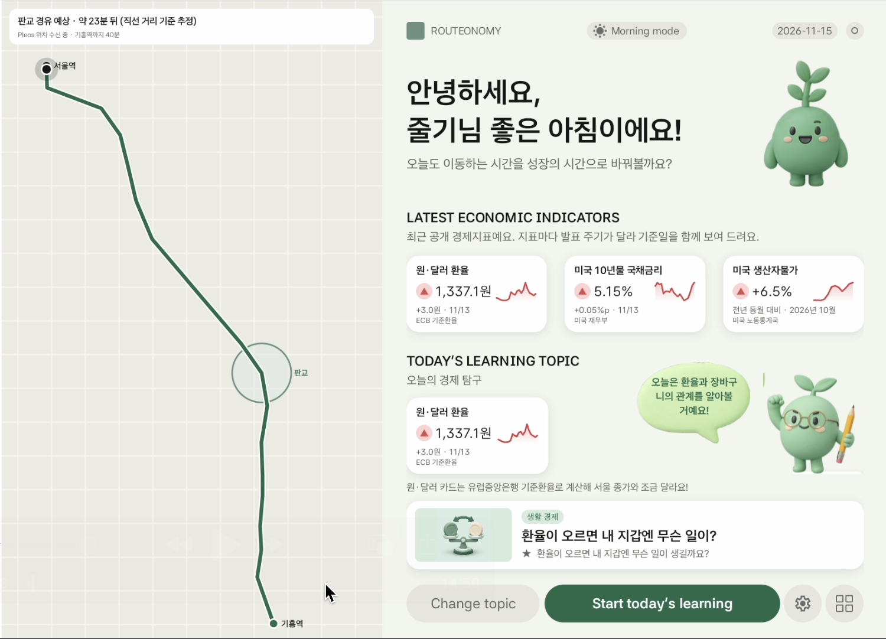 | 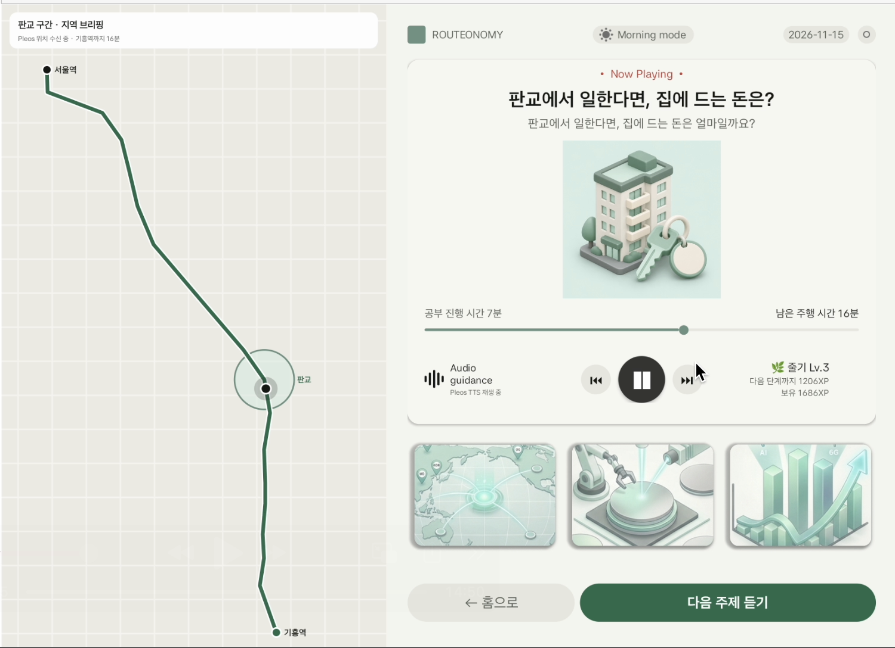 |
| 공개 경제지표를 확인하고 첫 학습 주제를 고릅니다. 출발하면 고른 이야기부터 재생합니다. | 판교에 들어서면 듣던 이야기를 마친 뒤 음성 안내와 함께 판교의 전월세 이야기로 넘어갑니다. |

| ③ 기흥역 도착 정리 | ④ 주차 후 퀴즈와 해설 |
| --- | --- |
| 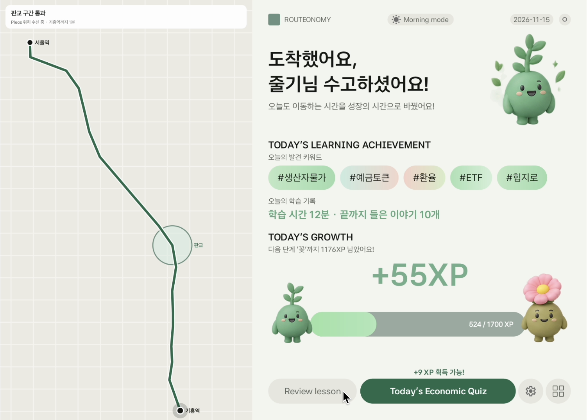 | 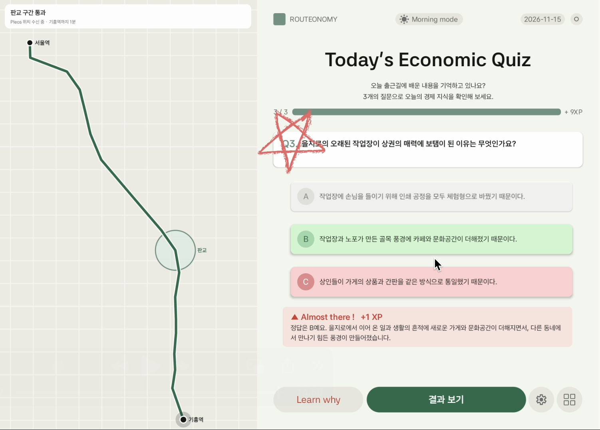 |
| 기어를 P로 바꾸면 학습 키워드, 학습 시간, 끝까지 들은 이야기 수, 이번 주행의 XP를 보여 줍니다. | 끝까지 들은 이야기에서 최대 3문항을 풀고, 제출하면 정답과 해설을 확인합니다. |

### ⑤ 레벨업

듣고 푼 만큼 쌓인 XP로 캐릭터가 다음 단계로 자라면, 오늘 학습을 마칠 때 축하 화면이 열립니다.

<p align="center">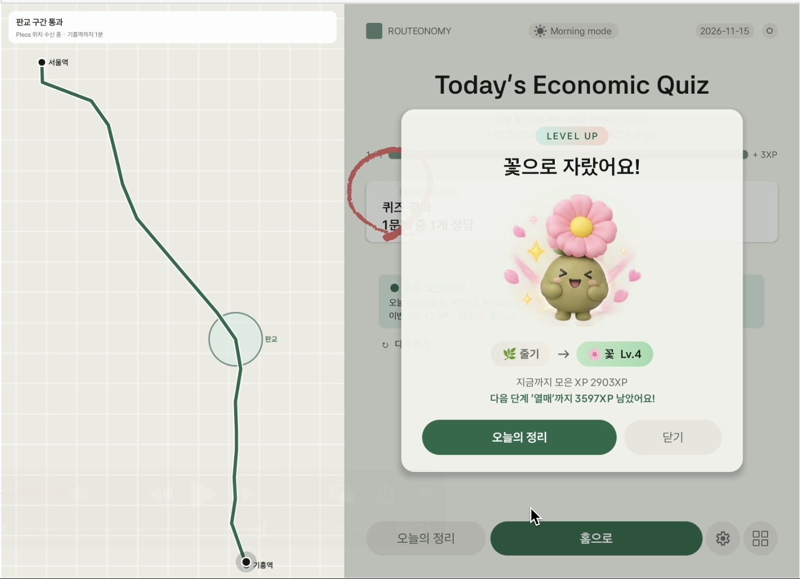</p>

<details>
<summary>주제 선택·퀴즈 힌트·정답 채점·학습 리뷰 화면 더 보기</summary>

| 주제 선택 | 퀴즈 힌트 |
| --- | --- |
| 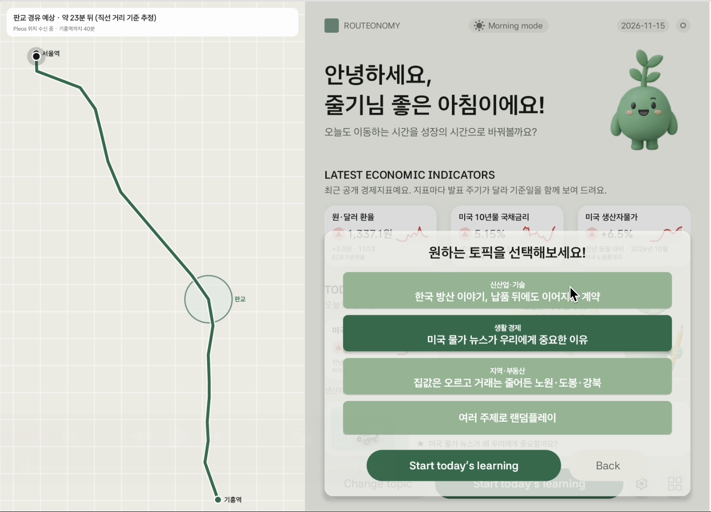 | 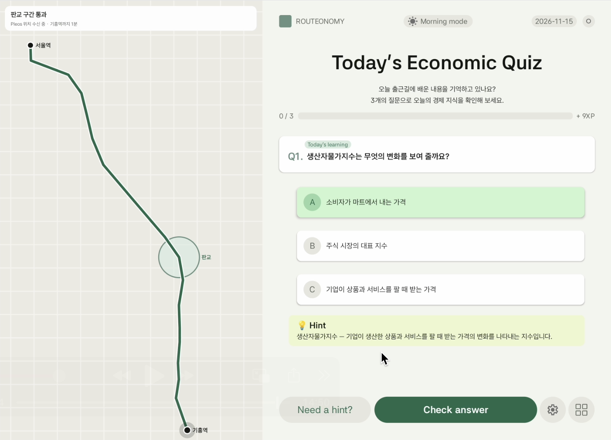 |

| 정답 채점 | 학습 리뷰 |
| --- | --- |
| 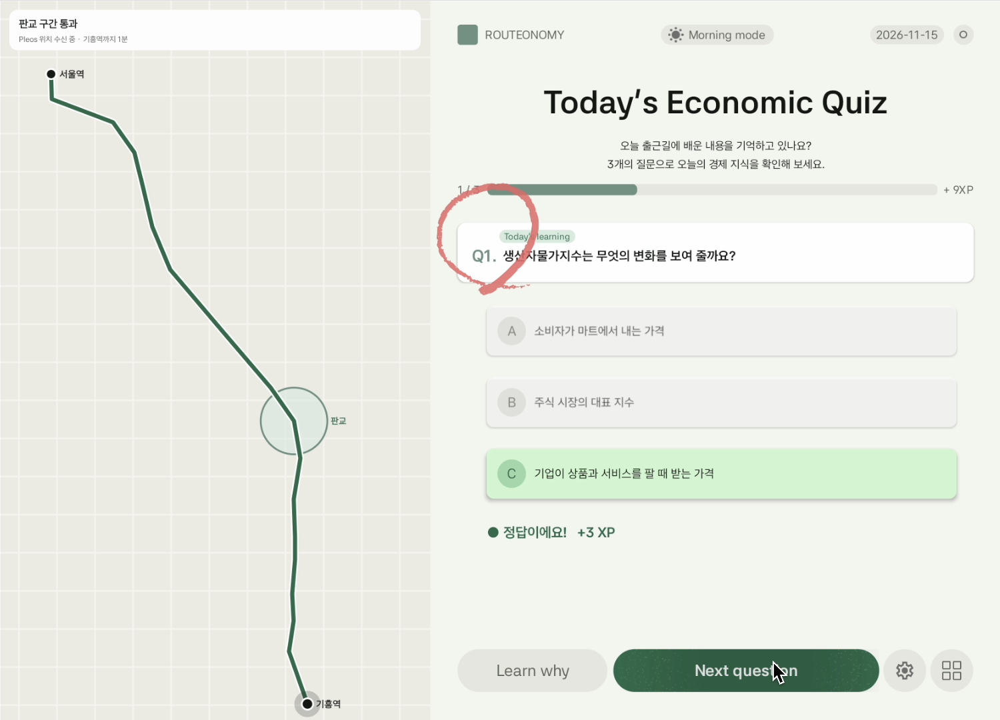 | 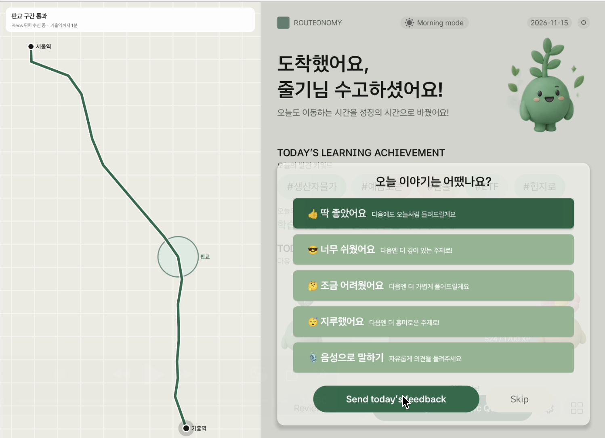 |

</details>

## 주요 기능

|   기능  | 동작 | 사용한 Pleos SDK |
| --- | --- | --- |
| **기어에 따라 바뀌는 화면** | 주행 화면(D·R·N)에서도 이전·다음 주제, 재생·일시정지, 홈 이동을 사용할 수 있습니다. 원고와 오늘의 발견은 P에서 열리고, 퀴즈에는 목적지 도착도 필요합니다. | **Vehicle** 기어 구독 |
| **남은 시간에 맞춘 브리핑 구성** | 서울역에서 기흥역까지의 기준 시간 40분을 남은 직선거리 비율로 줄여 주행 시간을 추정합니다. 예상 경유지가 있으면 그곳까지의 시간으로 일반 이야기를 고르고, 지역 진입 뒤에는 목적지까지의 시간으로 지역 이야기를 고릅니다. 대시보드에서 선택한 첫 주제는 시간 예산에 관계없이 먼저 배치하고, 이어서 **고른 분류 2편마다 다른 분류 1편**을 섞습니다. 지역 이야기를 마친 뒤 시간이 남으면 아직 듣지 않은 이야기를 이어서 들려줍니다. | **FusedLocation** 현재 위치 |
| **지역 브리핑** | 현재 위치와 목적지에서 후보 지역까지의 직선거리를 비교해 경유지를 예상합니다. 판교 반경 진입이 확인되면 듣던 이야기를 마친 뒤 지역 브리핑으로 전환합니다. 재생 중이거나 일시정지한 이야기가 없으면 바로 전환합니다. | **FusedLocation** 현재 위치 + 근접 알림(ENTER/EXIT) |
| **음성 브리핑** | 원고를 문장 단위로 한국어 음성으로 읽습니다. 이전·다음 주제로 이동할 수 있고, 일시정지하거나 홈에 다녀오면 멈춘 문장의 처음부터 이어 듣습니다. | **TextToSpeech** (`ON_DEVICE`) |
| **경로 그림** | 앱에 저장된 좌표로 시연 경로와 판교 반경을 직접 그리고, 수신한 현재 위치를 그 위에 표시합니다. | **FusedLocation** 현재 위치 |
| **도착 판정** | 현재 위치를 기흥역 반경 300m와 비교하고, 같은 반경에 등록한 근접 알림도 받습니다. 두 경로에서 같은 진입을 감지하면 한 번만 처리하고, 도착 상태는 반경을 벗어나도 유지합니다. | **FusedLocation** 현재 위치 + 근접 알림 |
| **오늘의 발견** | P에서 주행 화면의 격자 버튼을 열면 끝까지 들은 이야기의 제목, 키워드, 경제 용어와 설명을 볼 수 있습니다. 원고에 출처가 있으면 첫 번째 출처도 표시합니다. | **Vehicle** 기어(P) · **TextToSpeech** 문장 완료 콜백 |
| **도착 후 퀴즈** | 도착 정리 화면에서 **Today’s Economic Quiz**를 누르면 끝까지 들은 이야기와 연결된 3지선다 문항을 청취 완료 순서로 최대 3개 풉니다. 각 문항은 브리핑에서 들은 경제 개념을 이해했는지 확인합니다. 1 XP를 쓰면 배운 용어의 설명을 힌트로 볼 수 있습니다. 답을 제출하면 채점 결과와 해설을 확인하고, 결과 화면에서 다시 풀 수 있습니다. 퀴즈 도중 기어를 바꿨다가 P로 돌아와도 이어서 풉니다. | **FusedLocation** 도착 판정 · **Vehicle** 기어(P) · **TextToSpeech** 문장 완료 콜백 |
| **오늘 학습 마치기** | 도착 정리의 **퀴즈 없이 마치기** 또는 퀴즈 결과의 **오늘 학습 마치기**를 누르면 레벨업 축하(있을 때) → 오늘의 리뷰(보내기·건너뛰기) → 홈의 **오늘 학습 완료**로 끝납니다. 도착 뒤 주행 화면은 오늘의 발견을 읽는 용도로만 열리고 음성은 다시 재생되지 않습니다. | **FusedLocation** 도착 판정 · **Vehicle** 기어(P) |
| **성장 단계** | 일반·지역 이야기를 끝까지 듣고 퀴즈에 답하면 XP가 쌓입니다. 누적 XP에 따라 캐릭터가 씨앗 → 새싹 → 줄기 → 꽃 → 열매로 자랍니다. | **TextToSpeech** 문장 완료 콜백 · 앱 내부 퀴즈 채점 |

위치가 갱신되면 현재 재생 중이거나 일시정지한 이야기를 유지하고, 아직 재생하지 않은 이야기를 예상 시간과 원고별 길이에 맞춰 다시 고릅니다. 다음 이야기의 길이를 판단할 때는 현재 이야기의 남은 재생 시간까지 따로 차감하지 않아, 실제 재생 시간은 추정과 달라질 수 있습니다.

| 활동 | 포인트 |
| --- | --- |
| 일반 이야기 끝까지 듣기 | +5 |
| 지역 이야기 끝까지 듣기 | +10 |
| 퀴즈 정답 / 오답 | +3 / +1 |
| 힌트 보기 | −1 |

성장 단계는 누적 획득 XP로 정해집니다. 같은 주행에서 이야기를 다시 듣거나 같은 문항을 다시 풀어도 XP는 한 번만 적립되며, 힌트 비용은 보유 XP에서 차감됩니다.

### 1차 시연과 2차 발전 계획

**1차 시연(이번 제출)에서 보여 주는 것**

- **실제로 동작하는 학습 흐름 전체**: 출발 전 주제 선택 → 남은 시간에 맞춘 음성 브리핑 → 판교 진입 시 지역 브리핑 전환 → 기흥역 도착 판정 → 주차 후 도착 정리·퀴즈·해설 → XP와 캐릭터 성장 → 오늘의 리뷰까지 한 번의 주행으로 이어집니다.
- **Pleos SDK 연동**: 기어(Vehicle), 차량 위치와 근접 알림(FusedLocation), 한국어 음성(TextToSpeech)을 실제 SDK로 받아 동작합니다.
- **팀이 직접 쓰고 검증한 콘텐츠**: 2026년 11월 소식을 바탕으로 한 원고 20편과 퀴즈 19문항이 앱에 들어 있습니다. 콘텐츠 서버 없이 앱 안의 JSON에서 읽습니다. 자세한 내용은 [오디오 브리핑 원고](#오디오-브리핑-원고)에 있습니다.
- **실시간 경제지표**: 홈의 경제지표 3종은 네트워크가 연결되면 공개 API에서 바로 조회합니다.
- **시연 범위**: 경로는 서울역 → 판교 → 기흥역 한 개, 지역 브리핑은 판교 한 곳입니다. 남은 시간은 내비 경로 대신 남은 직선거리로 추정합니다([에뮬레이터 제약과 대응](#에뮬레이터-제약과-대응)).

**2차에서 발전시킬 것**

| 구분 | 1차 시연 | 2차 목표 |
| --- | --- | --- |
| **콘텐츠 수집** | 앱에 넣어 둔 원고 20편 | 콘텐츠 서버가 이용 조건을 확인한 뉴스 피드와 공식 자료를 수집하고, 같은 사건을 다룬 보도를 묶어 출근·퇴근 시간대마다 2~3개 주제를 준비합니다. [한국은행 RSS](https://www.bok.or.kr/static/view/popup/rss_popup.html) · [금융감독원 OpenDART](https://opendart.fss.or.kr/guide/detail.do?apiGrpCd=DS001&apiId=2019001) |
| **원고 작성** | 팀이 직접 쓰고 출처를 대조해 검수 | 생성형 AI API가 무슨 일이 있었는지, 왜 중요한지, 어떤 경제 개념과 이어지는지 짧은 원고로 초안을 만듭니다. 금리나 기업 실적처럼 수치가 중요한 이슈는 공식 보도자료·전자공시와 대조하고, 초기에는 사람이 수치와 출처를 검수한 원고만 배포합니다. |
| **최신 소식 반영** | 제출 시점의 원고로 고정 | 서버가 중요 이슈를 감지하면 검증을 마친 원고를 차량에 보냅니다. 앱은 재생 중인 이야기를 마친 뒤 남은 시간에 들어가는 새 원고를 이후 순서에 넣고, 통신이 끊기면 기기에 저장된 브리핑으로 이어갑니다. |
| **오늘의 발견** | 원고의 첫 번째 출처 표시 | 주차 후 원문 기사와 자료를 직접 확인할 수 있게 확장합니다. |

## 직접 실행해 보기

### 필요한 환경

이 앱은 Pleos SDK(기어, 위치, 음성)를 사용하므로 **Pleos Connect 에뮬레이터에서 실행해야 합니다.** 일반 Android 기기나 에뮬레이터에서는 기어·위치·음성 기능이 동작하지 않습니다.

| 항목 | 내용 |
| --- | --- |
| 에뮬레이터 | Pleos Connect v2.1.0 AVD (Android 14, API 34) |
| 화면 규격 | 2560 × 1440 px, 160 dpi (전체 창 기준. 1200dp보다 좁은 반반 분할 창도 지원) |
| 앱 | [Releases v1.0.0](https://github.com/beolene1/ROUTEONOMY/releases/tag/v1.0.0)의 `Carconomy_Routeonomy_release.apk` (31MB, 저장소의 [`apk/`](apk/Carconomy_Routeonomy_release.apk)에도 같은 파일이 있습니다). 직접 빌드하는 방법은 [직접 빌드하기](#직접-빌드하기)에 있습니다. |
| 체험용 경로 | 앱 안 **시연 주행** 버튼(3·5·10배속)이면 따로 준비할 것이 없습니다. 에뮬레이터 경로 재생을 쓰려면 [`tools/demo-route.gpx`](tools/demo-route.gpx)를 내려받습니다(서울역 → 판교 → 기흥역, 1배속 40분). |

### 설치

1. [Releases v1.0.0](https://github.com/beolene1/ROUTEONOMY/releases/tag/v1.0.0)의 **Assets**에서 `Carconomy_Routeonomy_release.apk`를 내려받습니다.
2. Pleos Connect 에뮬레이터를 켜고, 내려받은 APK를 에뮬레이터 창에 끌어다 놓습니다. 터미널을 쓴다면 APK를 내려받은 폴더에서 다음 명령으로 설치합니다.

   ```bash
   adb install -r Carconomy_Routeonomy_release.apk
   ```

3. 같은 패키지(`com.routeonomy.app`)의 디버그 빌드가 이미 설치되어 있으면 서명이 달라 설치가 거절됩니다. 이때는 먼저 지운 뒤 다시 설치합니다.

   ```bash
   adb uninstall com.routeonomy.app
   ```

내려받은 파일이 맞는지 확인하려면 SHA-256 값이 `1a8cd245c7193c3b19d4724ae02480170415fd771b31eafd09f84da06712e463`인지 비교합니다(macOS: `shasum -a 256 Carconomy_Routeonomy_release.apk`).

### 체험 순서

1. **출발 위치 정하기** — 에뮬레이터 `⋯`(Extended controls) → **Location**에서 단일 지점을 서울역 `37.55594, 126.97233`으로 지정합니다.
2. **앱 실행** — 차량 화면 앱 목록에서 Routeonomy 아이콘을 눌러 엽니다. 차량 권한 요청이 뜨면 **항상 허용**을 누릅니다. `adb shell am start`로 띄우면 기어 D에서 Pleos가 화면을 '주행 중에는 사용할 수 없습니다'로 가리므로, 반드시 아이콘으로 실행합니다. 왼쪽 경로 그림 위에 `기흥역까지 40분`이 보이면 준비가 끝난 것입니다.
3. **브리핑 시작** — 대시보드에서 주제를 고르고 **Start today's learning**을 누릅니다.
4. **주행 시작** — 둘 중 하나로 위치를 움직이고, Virtual Console에서 기어를 **D**로 바꿉니다.
   - **앱 안 시연 주행(간편)**: 주행 화면(P)의 ⚙ 버튼 → 시뮬레이션 입력에서 **시연 주행 3배속**(약 13분) · **5배속**(약 8분) · **10배속**(약 4분)을 누릅니다. 앱이 경로를 따라 1초마다 위치를 옮기며, 같은 패널에서 일시정지할 수 있습니다. 한 번 쓰면 앱을 다시 켤 때까지 에뮬레이터 위치는 무시합니다.
   - **에뮬레이터 GPX**: Location → **Routes**에서 체험용 GPX를 불러와 재생합니다(3~5배속 권장).
   - 5배속이면 약 4.5분 뒤 판교에 들어섭니다. 듣던 이야기가 끝나면 판교 이야기로 넘어갑니다.
5. **도착과 퀴즈** — 기흥역에 도착하면 기어를 **P**로 바꿉니다. 도착 정리 화면에서 이번 주행의 학습 기록을 확인하고 **Today’s Economic Quiz**를 눌러 퀴즈를 시작합니다. 퀴즈를 마치면 **오늘 학습 마치기**로 리뷰를 남기고 홈으로 돌아갑니다.

### 알아 두면 좋은 점

- **퀴즈는 끝까지 들은 이야기에서만 나옵니다.** 배속 재생으로 이야기를 다 듣기 전에 도착하면 문항이 적을 수 있습니다.
- **위치가 바뀌지 않을 때**는 Location 단일 지점을 판교 직전 `37.41632, 127.09543` → 판교 `37.40159, 127.10842` → 기흥역 `37.27566, 127.11595` 순서로 직접 옮겨도 같은 흐름을 볼 수 있습니다.
- **성장 단계를 바로 보고 싶다면** P 상태에서 ⚙ 버튼 → 시뮬레이션 입력의 `다음 단계 직전`을 누른 뒤 일반 또는 지역 이야기 하나를 끝까지 들어 보세요. `XP 초기화`로 처음 상태로 돌아갈 수 있습니다.
- 도착과 '오늘 학습 완료'는 한 번 처리되면 유지됩니다. 처음부터 다시 체험하려면 에뮬레이터 위치를 서울역으로 돌려 둔 뒤 앱을 다시 실행하세요.
- 에뮬레이터에서 음성이 떨리는 것은 에뮬레이터 오디오 특성입니다.

## Pleos SDK 활용

`MainActivity`는 `pleos` 패키지의 어댑터를 통해 SDK와 통신합니다. 기어·위치·음성 이벤트는 주행 상태와 브리핑에 반영하고, `NaviHelper` 응답은 시뮬레이션 패널의 진단 정보로 표시합니다.

| SDK 및 연결 코드 | 앱에서 하는 일 |
| --- | --- |
| **[Vehicle 2.3.2](app/src/main/java/com/routeonomy/app/pleos/GearMonitor.java)** | `Vehicle.getGear()`로 기어에 연결하고, `getCurrentGearSelectionState`와 `registerGearSelection`으로 현재 값과 이후 변경을 받습니다. 기어에 맞춰 화면을 바꾸고, 도착과 P가 함께 확인되면 도착 정리 화면을 엽니다. |
| **[FusedLocation 1.1.3](app/src/main/java/com/routeonomy/app/pleos/FusedLocationSource.kt)** | `registerFusedLocationCallback`으로 차량 위치를 받아 경로 그림, 남은 시간, 경유 예상 지역을 갱신합니다. `addProximityAlert`로 판교와 기흥역 반경의 ENTER·EXIT도 구독해 위치 기반 판정과 함께 사용합니다. |
| **[TextToSpeech 3.3.1](app/src/main/java/com/routeonomy/app/pleos/PleosTtsSpeaker.kt)** | `ON_DEVICE` 모드의 `speak`와 `stop`으로 한 문장씩 재생하고, `EventListener`에서 문장 완료를 받습니다. 마지막 문장까지 재생한 기록을 오늘의 발견, 퀴즈, XP에 사용합니다. |
| **[NaviHelper 3.0.5](app/src/main/java/com/routeonomy/app/pleos/NaviEtaClient.kt)** | 앱 시작 후 SDK가 연결되면 `getDestinationInfo`로 목적지 정보를 요청합니다. P 상태의 시뮬레이션 입력에서 **NaviHelper ETA 조회**로 다시 요청할 수 있습니다. 응답의 `remainTime`과 `remainDistance` 원시값은 진단 패널에만 표시합니다. |

권한은 `pleos.car.permission.CAR_DRIVE`, `FUSED_LOCATION`, `TTS_SERVICE`, `NAVI_ROUTE`를 선언하고, 위치 권한은 첫 실행 때 요청합니다.

### 외부 경제지표 API와 데이터 출처

홈 대시보드는 아래 공개 데이터에 앱에서 직접 접속합니다. 지표마다 마지막으로 성공한 값을 기기에 저장합니다. 조회에 실패하면 해당 지표에 `저장값`을 표시하고, 저장된 값도 없으면 `조회 불가`로 표시합니다. 브리핑은 지표 조회를 기다리지 않고 시작할 수 있습니다.

| 홈에서 표시하는 지표 | 출처와 표시 방식 |
| --- | --- |
| **원·달러 환율** | Frankfurter v1이 ECB 기준환율을 미국 달러(USD) 기준 한국 원화(KRW)로 환산한 시계열을 받습니다. [Frankfurter v1 API](https://frankfurter.dev/v1/) · [Frankfurter 데이터 이용 조건](https://frankfurter.dev/license/) · [ECB 환율 원자료](https://www.ecb.europa.eu/stats/policy_and_exchange_rates/euro_reference_exchange_rates/html/index.en.html) |
| **미국 10년물 국채금리** | 미국 재무부의 일별 수익률 곡선에서 10년물 금리(`BC_10YEAR`)를 읽습니다. [미국 재무부 일별 금리 XML 피드](https://home.treasury.gov/treasury-daily-interest-rate-xml-feed) |
| **미국 생산자물가** | 미국 노동통계국(BLS)의 월별 최종수요 생산자물가지수(`WPUFD4`)를 받아 앱에서 전년 동월 대비 변화율을 계산합니다. 위 캡처의 BLS 데이터 조회일은 2026-11-15입니다. [BLS Public Data API](https://www.bls.gov/developers/) · [BLS API 이용 약관](https://www.bls.gov/developers/termsOfService.htm) |

> BLS.gov cannot vouch for the data or analyses derived from these data after the data have been retrieved from BLS.gov.

### 오디오 브리핑 원고

주행 중 들려주는 원고는 팀이 직접 썼습니다. 2026년 11월의 경제·산업 소식을 바탕으로, 경제 공부를 막 시작한 사회초년생이 운전하면서 귀로만 들어도 따라올 수 있게 구성했습니다.

- **뉴스에서 내 생활로**: "요즘 뉴스에서 자주 들리는 그 말"로 시작해, 왜 그런 일이 생겼는지 설명하고 내 대출·지갑·출퇴근 동네와 어떻게 이어지는지로 마무리합니다.
- **원고마다 경제 용어 하나**: 원고마다 배우는 용어를 하나씩 정해 두고, 주차 후 '오늘의 발견'과 퀴즈에서 다시 확인하게 해 들은 내용이 학습으로 남도록 했습니다.
- **출처를 확인한 원고**: 수치와 사건을 다룬 원고 15편은 정부·중앙은행·통계기관 자료와 보도를 대조해 확인했고, 확인한 출처 36건을 원고와 함께 앱에 담았습니다. 나머지 4편은 따로 인용한 수치나 사건이 없는 개념 설명 원고입니다.

원고 전문, 배우는 용어, 출처는 <strong><a href="docs/SCRIPTS.md">오디오 브리핑 원고 모음</a></strong>에서 볼 수 있습니다.

<details>
<summary>원고 목록 보기 (일반 15편 · 판교 4편 · 마무리 1편)</summary>

| 분류 | 원고 제목 | 배우는 용어 |
| --- | --- | --- |
| 생활 경제 | 금리가 움직이면 생기는 일 | 국채금리 |
| 생활 경제 | 환율이 오르면 내 지갑엔 무슨 일이? | 수입물가지수 |
| 생활 경제 | 미국 물가 뉴스가 우리에게 중요한 이유 | 생산자물가지수 |
| 생활 경제 | 코스피 주식보다 많이 거래된 ETF | 상장지수펀드 |
| 신산업·기술 | AI 시대, 반도체가 중요한 이유 | HBM |
| 신산업·기술 | 전력망 투자의 시간 | 송전망 |
| 신산업·기술 | 데이터센터 냉각 산업 | 액체 냉각 |
| 신산업·기술 | 전력 저장의 역할 | ESS |
| 신산업·기술 | 효율 경쟁의 새로운 기준 | 와트당 성능 |
| 신산업·기술 | 전기차 충전기에 쓰이는 예금 토큰 | 예금 토큰 |
| 신산업·기술 | 우주 산업, 이제는 돈이 된다 | 위성 데이터 |
| 신산업·기술 | 한국 방산 이야기, 납품 뒤에도 이어지는 계약 | 수명주기비용 |
| 신산업·기술 | 젠슨 황 사임 뒤, 반도체 시장은 무엇을 볼까 | 가이던스 |
| 지역·부동산 | 을지로, 힙지로가 된 이유 | 장소성 |
| 지역·부동산 | 집값은 오르고 거래는 줄어든 노원·도봉·강북 | 매매 거래량 |
| 지역·부동산 | 판교에서 일한다면, 집에 드는 돈은? (판교 진입 후) | 전월세 전환율 |
| 지역·부동산 | 판교 오피스와 부동산 금융 (판교 진입 후) | 리츠 |
| 지역·부동산 | 판교에 모인 산업 (판교 진입 후) | 산업 클러스터 |
| 지역·부동산 | 판교 키워드로 보는 신사업 (판교 진입 후) | 실증 사업 |
| 마무리 | 오늘의 핵심 정리 | 복습 |

</details>

<details>
<summary>원고 예시: 금리가 움직이면 생기는 일 (약 2분 15초)</summary>

> 요즘 뉴스에서 미국 국채금리라는 말이 자주 들리죠. 미국 금리가 내 대출 이자와 무슨 상관인지, 오늘 함께 풀어 보겠습니다. 먼저 금리에는 두 종류가 있습니다. 중앙은행이 정하는 기준금리, 그리고 시장에서 돈을 빌리고 빌려주며 매일 정해지는 시장금리입니다. 미국 10년물 국채금리는 미국 정부가 10년 동안 돈을 빌릴 때 내는 이자로, 세계에서 가장 많이 참고하는 시장금리입니다. 미국 재무부 자료를 보면 이 금리는 11월 2일 4.91퍼센트에서 11월 13일 5.15퍼센트로 올랐습니다. 열흘 남짓한 사이에 0.24퍼센트포인트가 오른 셈입니다. 왜 올랐을까요? 미국 중앙은행인 연준은 지난 9월 기준금리를 0.25퍼센트포인트 올렸고, 10월 28일 회의에서는 3.75에서 4퍼센트 범위로 동결했습니다. 하지만 위원 두 명은 추가 인상을 주장했습니다. 물가가 쉽게 잡히지 않자 시장은 금리가 더 오를 수 있다고 보고, 미리 더 높은 이자를 요구하고 있는 겁니다. 이 흐름은 우리나라와도 이어집니다. 한국은행은 7월과 8월 연속으로 기준금리를 올린 뒤, 10월 22일 연 3퍼센트에서 동결하면서 추가 인상의 시기와 속도를 판단하겠다고 밝혔습니다. 우리가 은행에서 받는 대출 금리는 기준금리뿐 아니라 은행이 돈을 빌려 오는 시장금리를 따라 움직입니다. 그래서 시장금리가 오르면 시간 차를 두고 대출 금리도 오르기 쉽고, 예금 금리도 함께 오를 수 있습니다. 홈 화면의 미국 10년물 국채금리 카드를 가끔 확인해 보세요. 내 대출과 예금이 어느 쪽으로 움직일지 미리 가늠하는 데 도움이 됩니다. 오늘의 용어는 국채금리입니다.

**배우는 용어 — 국채금리**: 정부가 국채를 발행해 돈을 빌릴 때 내는 이자율로, 대출 금리 등 여러 시장금리의 기준이 됩니다.

출처: [미국 재무부 일별 수익률 곡선](https://home.treasury.gov/resource-center/data-chart-center/interest-rates/TextView?type=daily_treasury_yield_curve&field_tdr_date_value_month=202611) · [미국 연방준비제도 FOMC 성명](https://www.federalreserve.gov/monetarypolicy/files/monetary20261028a1.pdf) · [뉴스1](https://www.news1.kr/economy/trend/6328320)

</details>

### SDK 이벤트가 앱 동작이 되기까지

차량에서 오는 SDK 신호 네 가지(기어, 위치, 근접 알림, 음성 완료)가 앱 안에서 어떤 판단을 거쳐 음성과 화면으로 바뀌는지 보여 주는 그림입니다. 노란 타원은 Pleos SDK, 주황 상자는 신호를 받아 상태를 판단하는 앱 코드, 갈색 상자는 사용자가 보게 되는 결과입니다.

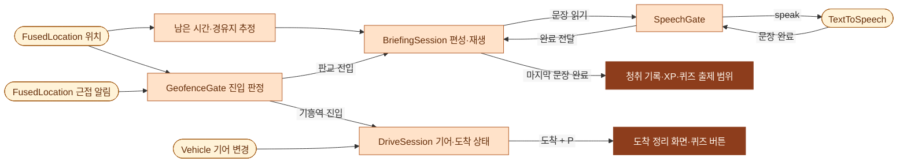

**주행 중에는 위치가 브리핑을 움직입니다.** FusedLocation 위치가 들어올 때마다 목적지까지 남은 직선거리로 남은 시간을 다시 추정하고, `BriefingSession`이 아직 재생하지 않은 이야기를 그 시간에 맞게 다시 고릅니다. 같은 위치는 `GeofenceGate`에도 들어가 판교와 기흥역 반경에 들어섰는지 판정합니다. Pleos 근접 알림(ENTER/EXIT)도 같은 곳으로 모여, 위치와 알림 중 먼저 온 신호 한 번만 진입으로 인정합니다. 판교 진입이 인정되면 듣던 이야기를 마친 뒤 판교 이야기로 넘어갑니다.

**음성은 문장 단위로 주고받습니다.** `BriefingSession`은 원고를 한 문장씩 `SpeechGate`를 거쳐 TextToSpeech에 읽게 하고, 문장 완료 신호를 받으면 다음 문장을 읽습니다. 한 이야기의 마지막 문장까지 완료 신호가 오면 그 이야기를 '끝까지 들은 이야기'로 기록합니다. 이 기록이 XP, 오늘의 발견, 퀴즈 출제 범위가 됩니다. 중간에 건너뛴 이야기는 기록되지 않습니다.

**도착 정리는 도착과 P가 모두 확인돼야 열립니다.** 기흥역 진입이 인정되면 `DriveSession`의 도착 상태가 '도착'으로 바뀌고, 반경을 잠깐 벗어나도 유지됩니다. Vehicle 기어 신호도 `DriveSession`에 들어가며, 도착과 P가 함께 성립할 때만 도착 정리 화면과 퀴즈 버튼이 열립니다. 도착 전에 P로 바꾸면 원고와 오늘의 발견은 볼 수 있지만 퀴즈는 열리지 않습니다.

### 구현하면서 신경 쓴 점

- **TTS 콜백 순서 보정**: 문장을 건너뛰면 `stop` 뒤에 멈춘 문장의 종료 콜백이 늦게 올 수 있습니다. 에뮬레이터에서 콜백 순서를 직접 기록해 확인했고, `SpeechGate`가 멈춘 문장의 콜백은 버리고 다음 문장을 이어 읽게 했습니다. 그래서 건너뛴 이야기가 '끝까지 들은 이야기'로 잘못 기록되지 않습니다.
- **위치 콜백과 근접 알림의 중복 제거**: `GeofenceGate`는 지역과 목적지별로 두 경로에서 온 진입을 한 번만 처리합니다. 첫 실제 위치가 이미 반경 안이면 반경 밖을 확인한 뒤의 진입부터 인정합니다.
- **스레드와 자원 정리**: SDK 콜백은 메인 스레드로 옮겨 처리하고, 앱이 끝날 때 리스너·근접 알림·SDK 연결을 모두 해제합니다.
- **SDK 우선, 시연 입력은 백업**: 시뮬레이션 입력은 SDK가 신호를 주지 못할 때만 쓰는 버튼입니다. 위치 이동 버튼과 앱 안 시연 주행도 FusedLocation 위치와 같은 처리 경로를 거쳐, 판정 로직은 하나만 둡니다.
- **주행 중 화면 유지**: 매니페스트에 `distractionOptimized`를 선언했고, 앱 목록에서 실행한 Routeonomy가 기어 D에서도 Pleos의 '주행 중에는 사용할 수 없습니다' 화면에 가려지지 않는 것을 에뮬레이터에서 확인했습니다. 주행 화면에는 큰 버튼 몇 개만 두고, 원고·오늘의 발견·퀴즈처럼 읽어야 하는 화면은 P에서만 엽니다.
- **지역 전환은 이야기 단위로**: 판교 진입을 감지해도 듣던 이야기를 끊지 않고 끝까지 들려준 뒤 넘어갑니다. 진입 전 이야기가 먼저 모두 끝나면 '판교 진입 대기'로 기다리고, 한 주행에서 지역 전환은 한 번만 처리합니다.
- **이야기 사이의 짧은 쉼**: 이야기가 끝날 때마다 알림음을 울리고 몇 초 쉰 뒤 다음 이야기를 읽습니다. 그 사이에 일시정지하거나 주제를 옮기면 예약해 둔 재생을 번호표(token)로 무효화해, 멈춘 뒤에 음성이 다시 나오지 않게 했습니다.
- **홈에 있을 때는 자동 재생 보류**: 홈 화면을 보는 동안에는 위치 갱신이나 지역 진입이 있어도 음성을 스스로 시작하지 않습니다. 다시 시작을 누르면 멈춘 문장의 처음부터 이어 듣습니다.
- **도착 뒤 상태 보존**: 도착 판정은 GPS가 반경 경계에서 흔들려도 풀리지 않게 유지합니다. 퀴즈 도중 기어를 D로 바꿨다가 P로 돌아오면 풀던 문항을 다시 열고, 도착 뒤에는 오늘의 발견만 볼 수 있게 재생을 잠급니다.
- **XP 중복 적립 방지**: 같은 주행에서 같은 이야기를 다시 듣거나 같은 문항을 다시 풀어도 보상은 한 번만 주고, 힌트 비용도 문항마다 한 번만 받습니다. 진행 상황은 바뀔 때마다 기기에 저장합니다.
- **화면 폭 대응**: 2560 × 1440 전체 창을 기준으로 만들고, 폭이 1200dp보다 좁은 반반 분할 창에서는 경로 그림과 정보 영역을 위아래로 배치합니다.
- **테스트와 CI**: 남은 시간 추정, 경유지 예측, 진입 판정, 재생 순서, 브리핑 편성, 퀴즈 채점, XP 규칙, TTS 콜백 보정을 JVM 단위 테스트 125개로 확인합니다. GitHub Actions가 push와 PR마다 `tools/verify.sh`(단위 테스트, lint, 디버그 빌드)를 실행합니다.

### 에뮬레이터 제약과 대응

| 제약 | 대응 |
| --- | --- |
| 시연에 사용할 경로 선형(polyline)과 구간별 소요 시간을 SDK에서 확보하기 어려웠습니다. | `demo_trip.json`에 저장한 시연 경로를 `RouteMapView`가 직접 그립니다. GPX는 같은 경로 좌표를 사용합니다. |
| 에뮬레이터에서 내비 위치가 고정되어 NaviHelper의 남은 시간이 GPX 재생을 따라가지 않았습니다. | GPX 재생을 따라가는 **FusedLocation** 위치로 남은 직선거리를 구해 시간을 추정합니다. NaviHelper 응답은 진단에 사용합니다. |
| 내비의 목적지 도착 이벤트를 에뮬레이터에서 재현하기 어려웠습니다. | **FusedLocation** 위치와 반경 300m 근접 알림을 함께 받아 기흥역 도착을 판정합니다. |

## 아키텍처

단일 Android `:app` 모듈에서 `ui/MainActivity`가 화면, SDK 어댑터, 저장소, 도메인 세션을 연결합니다. `domain`에는 남은 시간 추정, 지역 진입, 브리핑 편성·재생, 퀴즈 채점, XP 규칙이 있습니다. `data`는 앱 내 JSON, 외부 지표 조회와 저장값, XP와 학습 피드백 저장을 담당합니다. `pleos`·`data`·`simulation`은 `domain`의 모델만 참조하고, `domain`은 Android, Pleos SDK, 다른 패키지를 전혀 참조하지 않아 JVM 단위 테스트로 바로 검증할 수 있습니다.

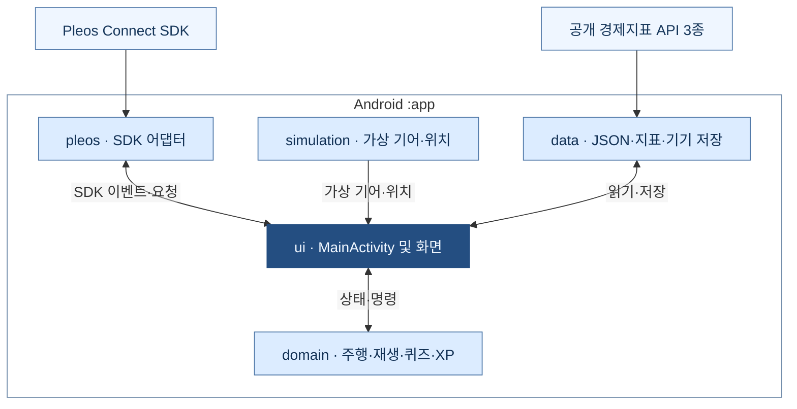

## 기술 스택

- **언어** — Kotlin, Java
- **화면** — Android Activity와 Views, AppCompat, Material Components
- **구성** — 단일 Android `:app` 모듈, Gradle Kotlin DSL, Version Catalog
- **Pleos SDK** — Vehicle 2.3.2, NaviHelper 3.0.5, FusedLocation 1.1.3, TextToSpeech 3.3.1
- **테스트** — JUnit 4 기반 JVM 단위 테스트
- **빌드** — Gradle 9.6.0, Android Gradle Plugin 9.5.1, compileSdk·targetSdk 37, minSdk 28

## 직접 빌드하기

Android Studio와 Android SDK 37이 필요합니다.

```bash
./gradlew :app:assembleDebug
adb install -r app/build/outputs/apk/debug/app-debug.apk
```

release APK는 `./gradlew :app:assembleRelease`로 만듭니다. 서명 키는 저장소에 없으며, `local.properties`의 `releaseSigningProperties`에 키 정보 파일 경로를 적으면 서명됩니다(없으면 서명 없이 빌드).

단위 테스트, lint, 디버그 빌드를 한 번에 확인하려면 다음을 실행합니다.

```bash
./tools/verify.sh
```

## 팀원

팀 카코노미(Carconomy)입니다. 기획은 두 사람이 함께 했습니다.

| 이름 | 역할 |
| --- | --- |
| yeonbyo ([@yeonbyo](https://github.com/yeonbyo)) | 기획 · 디자인 |
| beolene ([@beolene1](https://github.com/beolene1)) | 기획 · 개발 |

## 참고

- [Pleos Connect SDK 공식 문서](https://document.pleos.ai/docs/pleos-only/connect-sdk-pleos/)
