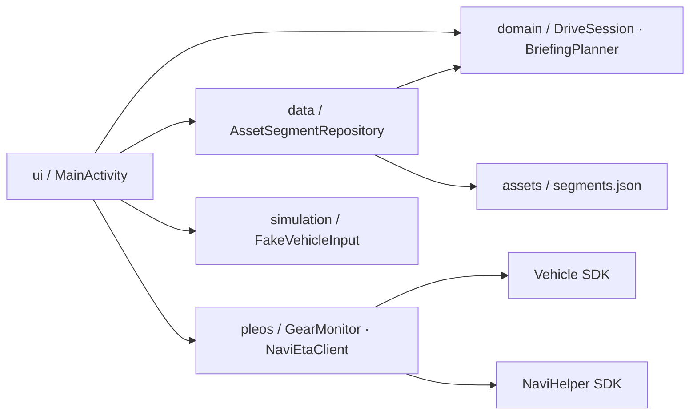

<div align="center">

# ROUTEONOMY

### 목적지까지의 경로를 넘어, 세상을 이해하는 경로로.

출퇴근 시간을 남은 시간과 이동 경로에 맞춘 오디오 브리핑으로 채우는
Pleos Connect 기반 차량용 Android 앱

**현대오토에버 App Dev Challenge 출품작**


</div>

---

## Demo

현재 저장소에는 공개용 시연 영상, GIF, 앱 스크린샷이 없습니다. 화면과 기능을 확인한 시연 자료가 준비되면 이곳에 추가합니다.

## Overview

출퇴근은 반복되지만, 그 시간을 따로 공부에 쓰기는 어렵습니다. ROUTEONOMY는 내비게이션의 남은 시간과 이동 중인 지역을 바탕으로 산업·경제 이야기를 들려주고, 도착 후 그날의 발견을 정리하는 앱입니다.

- **대상 사용자:** 자가용으로 출퇴근하는 직장인
- **해결 방식:** 남은 시간에 맞는 길이의 브리핑을 구성하고, 지역별 이야기를 더합니다.
- **콘텐츠 원칙:** 투자 권유 대신 산업과 개념을 설명합니다.
- **1차 콘텐츠:** 서버 없이 앱에 포함한 로컬 JSON을 사용합니다.
- **오디오 분류 검토:** 팟캐스트형 오디오 브리핑을 지향합니다. Pleos Music/Audio 등록 적합성과 하위 분류는 확인 중입니다.

## Key Features

| 기능 | 계획된 동작 | 현재 구현 상태 |
|---|---|---|
| F1 기어 모드 | D/R/N은 주행, P는 주차 화면으로 전환 | Vehicle SDK 연결 및 Fake 입력 구현. AVD 최종 동작 점검 남음 |
| F2 남은 시간 | NaviHelper 잔여 시간·거리 반영, 테스트 기본 ETA 사용 | 조회 콜백 연결. `remainTime` 단위 미확인이라 15분 테스트 ETA 사용 |
| F3 브리핑 플래너 | 남은 시간 안에서 로컬 콘텐츠 구성 | `segments.json` 기반 시간 예산 플래너 구현 |
| F4 음성 브리핑 | 선택된 세그먼트를 순서대로 TTS 재생 | Pleos TTS `ON_DEVICE` 구현(PR #8). 사용자가 AVD 실제 음성을 확인했으며, 재개·다음 주제 흐름 점검은 남음 |
| F5 지역 브리핑 | 지정 지역 진입 시 지역 콘텐츠 삽입 | 미구현 |
| F6 주행 화면 | ETA·현재 주제 중심의 최소 UI | 화면 골격 구현. 주행 제한을 포함한 AVD 검증은 남음 |
| F7 오늘의 발견 | 완주 브리핑의 주제·용어·출처 표시 | 별도 구현(PR #9). F4 완료 기록 통합과 AVD 검증은 남음 |
| 도착 후 퀴즈 | 도착·정차 후 콘텐츠 기반 퀴즈 | 시연용 화면만 있음. 문항·채점 미구현 |

> 주차(P)와 목적지 도착은 별도 상태입니다. P단 진입만으로 퀴즈를 열지 않습니다.

## User Flow

아래는 목표 사용자 흐름입니다. 현재 앱에서 전체 시나리오가 동작하는 것은 아닙니다.

1. 내비게이션 목적지를 설정하고 주행을 시작합니다.
2. 앱은 남은 시간에 맞춰 로컬 콘텐츠 세그먼트를 선택합니다.
3. 이동 중 ETA가 바뀌면 아직 시작하지 않은 브리핑을 다시 구성합니다.
4. 지정 지역 진입 기능이 연결되면 해당 지역 브리핑을 현재 이야기 뒤에 넣습니다.
5. 목적지 도착 후 정차하면 오늘의 발견과 퀴즈를 제공합니다.

F4 음성은 Pleos AVD에서 사용자가 실제로 확인했습니다. F4/F7 통합, 지역 진입, 도착 후 퀴즈까지 이어지는 전체 흐름은 아직 완성되지 않았습니다.

## Pleos SDK Integration

| SDK/API | 앱에서의 용도 | 프로젝트 연결 상태 |
|---|---|---|
| Vehicle SDK 2.3.2 | P/D/R/N 기어 이벤트 | 구현됨. `CAR_DRIVE` 권한 선언 |
| NaviHelper 3.0.5 | 목적지 잔여 시간·거리 조회 | 콜백 연결됨. `remainTime` 단위와 자동 갱신 반영은 미확인 |
| TextToSpeech 3.3.1 | 브리핑 음성 출력 | PR #8에서 `ON_DEVICE` 연결. 사용자가 음성을 확인했으며 약간의 끊김 원인은 미확인 |
| FusedLocation | 지역 진입 이벤트 | 미연결. AVD 지원과 권한 접근 미검증 |
| SpeechToText | 음성 인식 | 1차 기능 범위에 포함되지 않음 |

Music/Audio 분류나 `android:appCategory="audio"` 설정만으로 TTS/STT 권한 또는 D단 실행이 보장되는 것은 아닙니다. 주행 허용 여부와 각 SDK 접근 권한은 별도로 확인합니다.

## Architecture

현재 코드는 단일 `:app` 모듈을 사용합니다.



`MainActivity`가 현재 화면과 연결 객체를 함께 구성합니다. 기본 브랜치에는 F4(PR #8)와 F7(PR #9)이 아직 병합되지 않았으며, 현재 구현 상태와 다음 우선순위는 [개발 현황](docs/DEVELOPMENT_STATUS.md)을 참고하세요. 세부 설계는 [ARCHITECTURE.md](docs/ARCHITECTURE.md)를 참고하세요.

## Tech Stack

- **언어:** Kotlin, Java
- **화면:** Android Activity와 Views, AppCompat, Material Components
- **구성:** 단일 Android `:app` 모듈, Gradle Kotlin DSL, Version Catalog
- **Pleos SDK:** Vehicle 2.3.2, NaviHelper 3.0.5
- **테스트:** JUnit 4 기반 JVM 단위 테스트
- **빌드:** Gradle 9.6.0, Android Gradle Plugin 9.5.1
- **SDK 설정:** compileSdk 37, targetSdk 37, minSdk 28
- **시연 환경:** Pleos Connect v2.1.0 AVD, Android API 34

## Getting Started

### 요구 사항

- Android Studio와 Android SDK
- Pleos Connect v2.1.0 API 34 AVD
- Pleos Maven 저장소 SDK를 내려받을 수 있는 개발 환경

### 빌드

```bash
git clone https://github.com/beolene1/ROUTEONOMY.git
cd ROUTEONOMY
./gradlew :app:assembleDebug
```

빌드된 앱은 Android Studio의 Pleos AVD에서 실행합니다. Pleos Virtual Console에서 기어·차량 상태를 바꿔 SDK 입력을 확인할 수 있습니다. 현재 D단에서는 Pleos 시스템이 앱을 가리므로 주행 화면 직접 확인이 제한됩니다.

자동 검증은 다음 명령으로 실행합니다.

```bash
./tools/verify.sh
```

## Development Status

**목표:** 2026년 11월 14일까지 시연 가능한 MVP, 11월 15일 1차 제출

현재 기능별 구현·검증 상태, 우선순위, Android Studio 재개 방법은 [docs/DEVELOPMENT_STATUS.md](docs/DEVELOPMENT_STATUS.md)에 기록합니다.

## Team

- [@beolene1](https://github.com/beolene1)

## References

- [현대오토에버 App Dev Challenge 개발 환경 안내](https://appdevchallenge.auto-hmg.io/guide/development)
- [Pleos Connect SDK 문서](https://document.pleos.ai/docs/pleos-only/connect-sdk-pleos/)
- [Pleos Music/Audio 앱 개발 가이드](https://document.pleos.ai/docs/pleos-only/vehicle-app-developer-guide/music-audio-app-developement-guide)
- [Pleos 주행 규제 개발 가이드](https://document.pleos.ai/docs/pleos-only/vehicle-app-developer-guide/driving-restriction-development-guide)
- [제품 명세](docs/PRODUCT.md)
- [아키텍처](docs/ARCHITECTURE.md)
