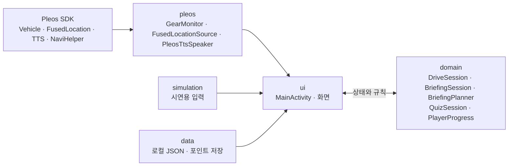

# Routeonomy

**출퇴근길에 듣는, 남은 시간과 지나가는 지역에 맞춘 경제 브리핑.**

자가용으로 출퇴근하는 직장인을 위한 Pleos Connect 차량용 앱입니다. 목적지까지 남은 시간에 맞춰 산업·경제 이야기를 들려주고, 지나가는 지역에 맞춰 주제를 바꿉니다. 도착해서 주차하면 오늘 들은 이야기를 돌아보고 퀴즈를 풀 수 있습니다. 듣고 푼 만큼 포인트가 쌓여 캐릭터가 씨앗에서 열매까지 자랍니다.

현대자동차그룹 차량용 앱 개발 공모전 출품작

## 서울역에서 기흥역까지

| 주행 장면 | 앱에서 볼 수 있는 동작 |
| --- | --- |
| **출발 전** | 대시보드에서 오늘의 학습 주제를 고르고 브리핑을 시작합니다. |
| **서울역에서 출발** | 남은 시간에 맞춰 일반 브리핑을 골라 음성으로 들려줍니다. 경로 그림에 현재 위치와 판교 구간이 표시됩니다. |
| **판교 진입** | 판교에 들어서면 전환 안내가 나오고, 듣던 이야기가 끝나면 판교의 산업·경제 이야기로 넘어갑니다. |
| **기흥역 도착 후 주차** | 목적지에 도착해 기어를 P로 바꾸면 축하 팝업과 함께 오늘의 발견과 퀴즈가 열립니다. |

## 주요 기능

- **기어에 따라 바뀌는 화면**: 주행 중(D)에는 큰 글씨의 Now Playing 카드와 최소한의 재생 버튼만 보여 줍니다. 원고, 다음 주제 고르기, 퀴즈는 주차(P) 상태에서만 열립니다.
- **남은 시간에 맞춘 브리핑 구성**: 목적지까지 남은 시간 안에 들을 수 있는 이야기를 조합합니다. 시간이 바뀌면 지금 듣는 이야기는 유지하고 그 뒤의 순서만 다시 짭니다.
- **지역 브리핑**: 경로에 있는 지역(시연 경로에서는 판교)을 지날 것으로 예상하고, 실제로 들어서면 그 지역의 산업 이야기로 이어 갑니다.
- **음성 브리핑**: Pleos TTS로 문장 단위로 읽습니다. 이전 주제·재생/일시정지·다음 주제를 지원하고, 홈에 다녀와도 멈춘 문장부터 이어 듣습니다.
- **오늘의 발견**: 주차 후 끝까지 들은 이야기의 주제, 키워드, 새로 배운 용어, 원문 출처를 정리해 보여 줍니다.
- **도착 후 퀴즈**: 끝까지 들은 이야기에서 최대 3문항을 냅니다. 힌트, 정답 확인, 해설, 다시 풀기를 지원합니다.
- **성장 단계**: 끝까지 들은 이야기와 퀴즈 답안으로 포인트가 쌓이고, 캐릭터가 씨앗 → 새싹 → 줄기 → 꽃 → 열매로 자랍니다.

| 활동 | 포인트 |
| --- | --- |
| 일반 이야기 끝까지 듣기 | +5 |
| 지역 이야기 끝까지 듣기 | +10 |
| 퀴즈 정답 / 오답 | +3 / +1 |
| 힌트 보기 | −1 |

하루 두 번(출근·퇴근) 주행 기준으로 새싹까지 2~3일, 열매까지 약 두 달이 걸리도록 맞췄습니다. 성장 단계는 지금까지 얻은 포인트로 정해져서, 힌트에 포인트를 써도 단계는 내려가지 않습니다.

브리핑 원고와 퀴즈 문항은 앱 안에 들어 있어 서버 없이 동작합니다. 투자 권유가 아니라 산업과 경제 개념을 이해하도록 돕는 콘텐츠입니다.

## 직접 실행해 보기

### 필요한 환경

이 앱은 Pleos SDK(기어, 위치, 음성)를 사용하므로 **Pleos Connect 에뮬레이터에서 실행해야 합니다.** 일반 Android 기기나 에뮬레이터에서는 기어·위치·음성 기능이 동작하지 않습니다.

| 항목 | 내용 |
| --- | --- |
| 에뮬레이터 | Pleos Connect v2.1.0 AVD (Android 14, API 34) |
| 앱 | 최신 APK는 [Releases](https://github.com/beolene1/ROUTEONOMY/releases)에 올라갑니다. 직접 빌드하는 방법은 아래 [직접 빌드하기](#직접-빌드하기)에 있습니다. |
| 체험용 경로 | [`tools/demo-route.gpx`](tools/demo-route.gpx) — 서울역 → 판교 → 기흥역, 1배속 40분 |

### 설치

에뮬레이터를 켠 뒤, APK 파일을 에뮬레이터 창에 끌어다 놓으면 설치됩니다. 터미널을 쓴다면 다음 명령으로도 설치할 수 있습니다.

```bash
adb install -r routeonomy.apk
```

### 체험 순서

1. **출발 위치 정하기** — 에뮬레이터 `⋯`(Extended controls) → **Location**에서 단일 지점을 서울역 `37.55594, 126.97233`으로 지정합니다.
2. **앱 실행** — Routeonomy를 열고 위치 권한 요청에서 **허용**을 누릅니다. 왼쪽 경로 그림 위에 `기흥역까지 40분`이 보이면 준비가 끝난 것입니다.
3. **브리핑 시작** — 대시보드에서 주제를 고르고 **Start today's learning**을 누릅니다.
4. **주행 시작** — Location → **Routes**에서 체험용 GPX를 불러와 재생하고(3~5배속 권장), Virtual Console에서 기어를 **D**로 바꿉니다.
   - 5배속이면 약 4.5분 뒤 판교에 들어섭니다. 듣던 이야기가 끝나면 판교 이야기로 넘어갑니다.
5. **도착과 퀴즈** — 기흥역에 도착하면 기어를 **P**로 바꿉니다. 축하 팝업에서 **퀴즈 풀러 가기**를 누르면 끝까지 들은 이야기로 퀴즈를 풀 수 있습니다.

### 알아 두면 좋은 점

- **퀴즈는 끝까지 들은 이야기에서만 나옵니다.** 배속 재생으로 이야기를 다 듣기 전에 도착하면 문항이 적을 수 있습니다.
- **위치가 바뀌지 않을 때**는 Location 단일 지점을 판교 직전 `37.41632, 127.09543` → 판교 `37.40159, 127.10842` → 기흥역 `37.27566, 127.11595` 순서로 직접 옮겨도 같은 흐름을 볼 수 있습니다.
- **성장 단계를 바로 보고 싶다면** P 상태에서 ⚙ 버튼 → 시뮬레이션 입력의 `다음 단계 직전`을 누른 뒤 이야기 하나를 끝까지 들어 보세요. `포인트 초기화`로 처음 상태로 돌아갈 수 있습니다.
- 도착은 한 번 처리되면 유지됩니다. 처음부터 다시 체험하려면 앱을 다시 실행하세요.
- 에뮬레이터에서 음성이 떨리는 것은 에뮬레이터 오디오 특성입니다.

## Pleos SDK 활용

| SDK | 맡은 역할 |
| --- | --- |
| Vehicle 2.3.2 | 기어 신호를 받아 주행 화면과 주차 화면을 전환합니다. |
| FusedLocation 1.1.3 | 위치와 근접 알림을 받아 경로 그림을 갱신하고, 지역 진입과 목적지 도착을 판정합니다. |
| TextToSpeech 3.3.1 | 한국어 브리핑을 문장 단위로 재생합니다. |
| NaviHelper 3.0.5 | 목적지까지 남은 시간과 거리를 조회합니다. 시연 경로의 남은 시간은 위치를 바탕으로 앱에서 추정합니다. |

## 아키텍처

단일 Android `:app` 모듈입니다. `domain`은 남은 시간 추정, 지역 진입 판정, 브리핑 구성과 재생 상태, 퀴즈 채점, 포인트와 성장 단계를 담당합니다. `data`는 로컬 JSON과 포인트 저장을, `pleos`는 차량 SDK 연결을, `simulation`은 시연용 입력을 맡습니다. 화면은 SDK를 직접 호출하지 않습니다.



패키지별 책임과 상태 흐름은 [아키텍처 문서](docs/ARCHITECTURE.md), 기능별 요구사항은 [제품 명세](docs/PRODUCT.md)에 있습니다.

## 기술 스택

- **언어** — Kotlin, Java
- **화면** — Android Activity와 Views, AppCompat, Material Components
- **구성** — 단일 Android `:app` 모듈, Gradle Kotlin DSL, Version Catalog
- **Pleos SDK** — Vehicle 2.3.2, NaviHelper 3.0.5, FusedLocation 1.1.3, TextToSpeech 3.3.1
- **테스트** — JUnit 4 기반 JVM 단위 테스트
- **빌드** — Gradle 9.6.0, Android Gradle Plugin 9.5.1, compileSdk·targetSdk 37, minSdk 28

## 직접 빌드하기

Android Studio와 Android SDK 37이 필요합니다.

```bash
./gradlew :app:assembleDebug
adb install -r app/build/outputs/apk/debug/app-debug.apk
```

단위 테스트, lint, 디버그 빌드를 한 번에 확인하려면 다음을 실행합니다.

```bash
./tools/verify.sh
```

## 참고

- [Pleos Connect SDK 공식 문서](https://document.pleos.ai/docs/pleos-only/connect-sdk-pleos/)

팀 [@beolene1](https://github.com/beolene1)
