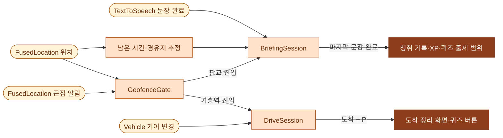
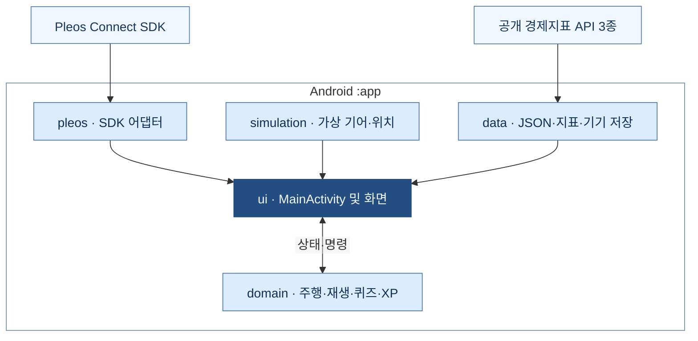

# Routeonomy

**출퇴근길에 듣는, 남은 시간과 지나가는 지역에 맞춘 경제 브리핑.**

자가용으로 출퇴근하는 직장인을 위한 Pleos Connect 차량용 앱입니다. 목적지까지 남은 시간에 맞춰 산업·경제 이야기를 들려주고, 지나가는 지역에 맞춰 주제를 바꿉니다. 도착해서 주차하면 오늘 들은 이야기를 돌아보고 퀴즈를 풀 수 있습니다. 듣고 푼 만큼 포인트가 쌓여 캐릭터가 씨앗에서 열매까지 자랍니다.

현대자동차그룹 차량용 앱 개발 공모전 출품작

> **Pleos Connect의 Vehicle, FusedLocation, TextToSpeech를 핵심 기능에 사용합니다.**
> 기어 상태에 맞춰 화면을 바꾸고, 차량 위치와 근접 알림으로 지역 진입과 도착을 판정합니다. 브리핑은 차량에서 한국어 음성으로 읽어 줍니다. [Pleos SDK 활용 자세히 보기](#pleos-sdk-활용)

## 서울역에서 기흥역까지


*Pleos Connect 에뮬레이터 캡처(2026-11-15). 넓은 창에서는 왼쪽 경로와 오른쪽 학습 화면을 함께 볼 수 있습니다.*

| 주행 장면 | 앱에서 볼 수 있는 동작 |
| --- | --- |
| **출발 전** | 대시보드에서 최근 공개 경제지표를 확인하고 첫 학습 주제를 고릅니다. |
| **서울역에서 출발** | 선택한 주제부터 듣고, 예상 경유지까지의 시간에 맞춰 일반 브리핑을 이어 갑니다. 경로 그림에는 현재 위치와 판교 반경이 표시됩니다. |
| **판교 진입** | 화면에 판교 진입이 표시됩니다. 듣던 이야기가 끝나면 음성 전환 안내와 함께 판교의 산업·경제 이야기로 넘어갑니다. |
| **기흥역 도착 후 주차** | 도착과 기어 P가 확인되면 도착 정리 화면에서 키워드, 학습 시간, 끝까지 들은 이야기 수, 이번 주행의 XP를 확인합니다. 들은 내용에 해당하는 문항이 있으면 퀴즈를 시작할 수 있습니다. |

## 주요 기능

| 기능 | 동작 | 사용한 Pleos SDK |
| --- | --- | --- |
| **기어에 따라 바뀌는 화면** | 주행 화면(D·R·N)에서도 이전·다음 주제, 재생·일시정지, 홈 이동을 사용할 수 있습니다. 원고와 오늘의 발견은 P에서 열리고, 퀴즈에는 목적지 도착도 필요합니다. | **Vehicle** 기어 구독 |
| **남은 시간에 맞춘 브리핑 구성** | 서울역에서 기흥역까지의 기준 시간 40분을 남은 직선거리 비율로 줄여 주행 시간을 추정합니다. 예상 경유지가 있으면 그곳까지의 시간으로 일반 이야기를 고르고, 지역 진입 뒤에는 목적지까지의 시간으로 지역 이야기를 고릅니다. 대시보드에서 선택한 첫 주제는 시간 예산에 관계없이 먼저 배치합니다. | **FusedLocation** 현재 위치 |
| **지역 브리핑** | 현재 위치와 목적지에서 후보 지역까지의 직선거리를 비교해 경유지를 예상합니다. 판교 반경 진입이 확인되면 듣던 이야기를 마친 뒤 지역 브리핑으로 전환합니다. 재생 중이거나 일시정지한 이야기가 없으면 바로 전환합니다. | **FusedLocation** 현재 위치 + 근접 알림(ENTER/EXIT) |
| **음성 브리핑** | 원고를 문장 단위로 한국어 음성으로 읽습니다. 이전·다음 주제로 이동할 수 있고, 일시정지하거나 홈에 다녀오면 멈춘 문장의 처음부터 이어 듣습니다. | **TextToSpeech** (`ON_DEVICE`) |
| **경로 그림** | 앱에 저장된 좌표로 시연 경로와 판교 반경을 직접 그리고, 수신한 현재 위치를 그 위에 표시합니다. | **FusedLocation** 현재 위치 |
| **도착 판정** | 현재 위치를 기흥역 반경 300m와 비교하고, 같은 반경에 등록한 근접 알림도 받습니다. 두 경로에서 같은 진입을 감지하면 한 번만 처리하고, 도착 상태는 반경을 벗어나도 유지합니다. | **FusedLocation** 현재 위치 + 근접 알림 |
| **오늘의 발견** | P에서 주행 화면의 격자 버튼을 열면 끝까지 들은 이야기의 제목, 키워드, 경제 용어와 설명을 볼 수 있습니다. 원고에 출처가 있으면 첫 번째 출처도 표시합니다. | **Vehicle** 기어(P) · **TextToSpeech** 문장 완료 콜백 |
| **도착 후 퀴즈** | 도착 정리 화면에서 **Today’s Economic Quiz**를 누르면 끝까지 들은 이야기와 연결된 3지선다 문항을 청취 완료 순서로 최대 3개 풉니다. 각 문항은 브리핑에서 들은 경제 개념을 이해했는지 확인합니다. 1 XP를 쓰면 배운 용어의 설명을 힌트로 볼 수 있습니다. 답을 제출하면 채점 결과와 해설을 확인하고, 결과 화면에서 다시 풀 수 있습니다. | **FusedLocation** 도착 판정 · **Vehicle** 기어(P) · **TextToSpeech** 문장 완료 콜백 |
| **성장 단계** | 일반·지역 이야기를 끝까지 듣고 퀴즈에 답하면 XP가 쌓입니다. 누적 XP에 따라 캐릭터가 씨앗 → 새싹 → 줄기 → 꽃 → 열매로 자랍니다. | **TextToSpeech** 문장 완료 콜백 · 앱 내부 퀴즈 채점 |

위치가 갱신되면 현재 재생 중이거나 일시정지한 이야기를 유지하고, 아직 재생하지 않은 이야기를 예상 시간과 원고별 길이에 맞춰 다시 고릅니다. 다음 이야기의 길이를 판단할 때는 현재 이야기의 남은 재생 시간까지 따로 차감하지 않아, 실제 재생 시간은 추정과 달라질 수 있습니다.

| 활동 | 포인트 |
| --- | --- |
| 일반 이야기 끝까지 듣기 | +5 |
| 지역 이야기 끝까지 듣기 | +10 |
| 퀴즈 정답 / 오답 | +3 / +1 |
| 힌트 보기 | −1 |

성장 단계는 누적 획득 XP로 정해집니다. 같은 주행에서 이야기를 다시 듣거나 같은 문항을 다시 풀어도 XP는 한 번만 적립되며, 힌트 비용은 보유 XP에서 차감됩니다.

### 1차 시연과 콘텐츠 개발 계획

**1차 시연**에서는 앱에 포함된 샘플 JSON에서 브리핑 원고, 경제 용어, 퀴즈, 지역·경로 정보를 읽습니다. 브리핑 재생과 복습은 콘텐츠 서버 없이 동작합니다. 홈의 최근 공개 경제지표는 네트워크가 연결되면 외부 API에서 조회합니다. 브리핑은 산업과 경제 개념을 이해하기 위한 교육용 콘텐츠입니다.

1. **출근·퇴근 브리핑부터 시작합니다.** 콘텐츠 서버가 이용 조건을 확인한 뉴스 피드와 공식 자료를 수집하고, 같은 사건을 다룬 보도를 묶어 시간대마다 2~3개 주제를 준비할 계획입니다. 금리나 기업 실적처럼 수치가 중요한 이슈는 공식 보도자료와 전자공시를 대조합니다. [한국은행 RSS](https://www.bok.or.kr/static/view/popup/rss_popup.html) · [금융감독원 OpenDART](https://opendart.fss.or.kr/guide/detail.do?apiGrpCd=DS001&apiId=2019001)
2. **생성형 AI API로 듣기 좋은 설명을 만듭니다.** 확인한 자료를 바탕으로 무슨 일이 있었는지, 왜 중요한지, 어떤 경제 개념과 연결되는지 짧은 한국어 원고로 구성합니다. 예를 들어 기준금리 동결 소식을 전한 뒤 대출금리가 달라질 수 있는 이유를 설명합니다. 초기에는 사람이 수치와 출처를 검수한 원고를 배포할 계획입니다. 앱은 남은 주행 시간에 맞춰 원고를 편성해 Pleos 음성 합성으로 들려주고, 주차 후 ‘오늘의 발견’에서 원문을 확인할 수 있도록 확장합니다.
3. **속보 반영은 다음 단계입니다.** 서버가 중요 이슈를 감지하면 검증을 마친 원고를 차량에 보냅니다. 앱은 재생 중인 이야기를 마친 뒤, 남은 시간에 들어가는 새 원고를 이후 순서에 편성할 계획입니다. 통신이 끊기거나 최신 원고가 준비되지 않으면 기기에 저장된 브리핑이나 기본 경제 콘텐츠로 이어갑니다.

## 직접 실행해 보기

### 필요한 환경

이 앱은 Pleos SDK(기어, 위치, 음성)를 사용하므로 **Pleos Connect 에뮬레이터에서 실행해야 합니다.** 일반 Android 기기나 에뮬레이터에서는 기어·위치·음성 기능이 동작하지 않습니다.

| 항목 | 내용 |
| --- | --- |
| 에뮬레이터 | Pleos Connect v2.1.0 AVD (Android 14, API 34) |
| 앱 | 최신 APK는 [Releases](https://github.com/beolene1/ROUTEONOMY/releases)에 올라갑니다. 직접 빌드하는 방법은 아래 [직접 빌드하기](#직접-빌드하기)에 있습니다. |
| 체험용 경로 | [`tools/demo-route.gpx`](tools/demo-route.gpx) — 서울역 → 판교 → 기흥역, 1배속 40분 |

### 설치

에뮬레이터를 켠 뒤, APK 파일을 에뮬레이터 창에 끌어다 놓으면 설치됩니다. 터미널을 쓴다면 다음 명령으로도 설치할 수 있습니다.

```bash
adb install -r routeonomy.apk
```

### 체험 순서

1. **출발 위치 정하기** — 에뮬레이터 `⋯`(Extended controls) → **Location**에서 단일 지점을 서울역 `37.55594, 126.97233`으로 지정합니다.
2. **앱 실행** — Routeonomy를 열고 위치 권한 요청에서 **허용**을 누릅니다. 왼쪽 경로 그림 위에 `기흥역까지 40분`이 보이면 준비가 끝난 것입니다.
3. **브리핑 시작** — 대시보드에서 주제를 고르고 **Start today's learning**을 누릅니다.
4. **주행 시작** — Location → **Routes**에서 체험용 GPX를 불러와 재생하고(3~5배속 권장), Virtual Console에서 기어를 **D**로 바꿉니다.
   - 5배속이면 약 4.5분 뒤 판교에 들어섭니다. 듣던 이야기가 끝나면 판교 이야기로 넘어갑니다.
5. **도착과 퀴즈** — 기흥역에 도착하면 기어를 **P**로 바꿉니다. 도착 정리 화면에서 이번 주행의 학습 기록을 확인하고 **Today’s Economic Quiz**를 눌러 퀴즈를 시작합니다.

### 알아 두면 좋은 점

- **퀴즈는 끝까지 들은 이야기에서만 나옵니다.** 배속 재생으로 이야기를 다 듣기 전에 도착하면 문항이 적을 수 있습니다.
- **위치가 바뀌지 않을 때**는 Location 단일 지점을 판교 직전 `37.41632, 127.09543` → 판교 `37.40159, 127.10842` → 기흥역 `37.27566, 127.11595` 순서로 직접 옮겨도 같은 흐름을 볼 수 있습니다.
- **성장 단계를 바로 보고 싶다면** P 상태에서 ⚙ 버튼 → 시뮬레이션 입력의 `다음 단계 직전`을 누른 뒤 일반 또는 지역 이야기 하나를 끝까지 들어 보세요. `XP 초기화`로 처음 상태로 돌아갈 수 있습니다.
- 도착은 한 번 처리되면 유지됩니다. 처음부터 다시 체험하려면 앱을 다시 실행하세요.
- 에뮬레이터에서 음성이 떨리는 것은 에뮬레이터 오디오 특성입니다.

## Pleos SDK 활용

`MainActivity`는 `pleos` 패키지의 어댑터를 통해 SDK와 통신합니다. 기어·위치·음성 이벤트는 주행 상태와 브리핑에 반영하고, `NaviHelper` 응답은 시뮬레이션 패널의 진단 정보로 표시합니다.

| SDK 및 연결 코드 | 앱에서 하는 일 |
| --- | --- |
| **[Vehicle 2.3.2](app/src/main/java/com/routeonomy/app/pleos/GearMonitor.java)** | `Vehicle.getGear()`로 기어에 연결하고, `getCurrentGearSelectionState`와 `registerGearSelection`으로 현재 값과 이후 변경을 받습니다. 기어에 맞춰 화면을 바꾸고, 도착과 P가 함께 확인되면 도착 정리 화면을 엽니다. |
| **[FusedLocation 1.1.3](app/src/main/java/com/routeonomy/app/pleos/FusedLocationSource.kt)** | `registerFusedLocationCallback`으로 차량 위치를 받아 경로 그림, 남은 시간, 경유 예상 지역을 갱신합니다. `addProximityAlert`로 판교와 기흥역 반경의 ENTER·EXIT도 구독해 위치 기반 판정과 함께 사용합니다. |
| **[TextToSpeech 3.3.1](app/src/main/java/com/routeonomy/app/pleos/PleosTtsSpeaker.kt)** | `ON_DEVICE` 모드의 `speak`와 `stop`으로 한 문장씩 재생하고, `EventListener`에서 문장 완료를 받습니다. 마지막 문장까지 재생한 기록을 오늘의 발견, 퀴즈, XP에 사용합니다. |
| **[NaviHelper 3.0.5](app/src/main/java/com/routeonomy/app/pleos/NaviEtaClient.kt)** | 앱 시작 후 SDK가 연결되면 `getDestinationInfo`로 목적지 정보를 요청합니다. P 상태의 시뮬레이션 입력에서 **NaviHelper ETA 조회**로 다시 요청할 수 있습니다. 응답의 `remainTime`과 `remainDistance` 원시값은 진단 패널에만 표시합니다. |

권한은 `pleos.car.permission.CAR_DRIVE`, `FUSED_LOCATION`, `TTS_SERVICE`, `NAVI_ROUTE`를 선언하고, 위치 권한은 첫 실행 때 요청합니다.

### 외부 경제지표 API와 데이터 출처

홈 대시보드는 아래 공개 데이터에 앱에서 직접 접속합니다. 지표마다 마지막으로 성공한 값을 기기에 저장합니다. 조회에 실패하면 해당 지표에 `저장값`을 표시하고, 저장된 값도 없으면 `조회 불가`로 표시합니다. 브리핑은 지표 조회를 기다리지 않고 시작할 수 있습니다.

| 홈에서 표시하는 지표 | 출처와 표시 방식 |
| --- | --- |
| **원·달러 환율** | Frankfurter v1이 ECB 기준환율을 미국 달러(USD) 기준 한국 원화(KRW)로 환산한 시계열을 받습니다. [Frankfurter v1 API](https://frankfurter.dev/v1/) · [Frankfurter 데이터 이용 조건](https://frankfurter.dev/license/) · [ECB 환율 원자료](https://www.ecb.europa.eu/stats/policy_and_exchange_rates/euro_reference_exchange_rates/html/index.en.html) |
| **미국 10년물 국채금리** | 미국 재무부의 일별 수익률 곡선에서 10년물 금리(`BC_10YEAR`)를 읽습니다. [미국 재무부 일별 금리 XML 피드](https://home.treasury.gov/treasury-daily-interest-rate-xml-feed) |
| **미국 생산자물가** | 미국 노동통계국(BLS)의 월별 최종수요 생산자물가지수(`WPUFD4`)를 받아 앱에서 전년 동월 대비 변화율을 계산합니다. 위 캡처의 BLS 데이터 조회일은 2026-11-15입니다. [BLS Public Data API](https://www.bls.gov/developers/) · [BLS API 이용 약관](https://www.bls.gov/developers/termsOfService.htm) |

> BLS.gov cannot vouch for the data or analyses derived from these data after the data have been retrieved from BLS.gov.

### SDK 이벤트가 앱 동작이 되기까지

도착과 P가 확인되면 퀴즈를 시작할 수 있는 화면이 열립니다. 출제 범위는 그동안 끝까지 들은 이야기로 정해집니다.



### 구현하면서 신경 쓴 점

- **TTS 콜백 순서 보정**: 문장을 건너뛰면 `stop` 뒤에 멈춘 문장의 종료 콜백이 늦게 올 수 있습니다. 에뮬레이터에서 콜백 순서를 직접 기록해 확인했고, `SpeechGate`가 멈춘 문장의 콜백은 버리고 다음 문장을 이어 읽게 했습니다. 그래서 건너뛴 이야기가 '끝까지 들은 이야기'로 잘못 기록되지 않습니다.
- **위치 콜백과 근접 알림의 중복 제거**: `GeofenceGate`는 지역과 목적지별로 두 경로에서 온 진입을 한 번만 처리합니다. 첫 실제 위치가 이미 반경 안이면 반경 밖을 확인한 뒤의 진입부터 인정합니다.
- **스레드와 자원 정리**: SDK 콜백은 메인 스레드로 옮겨 처리하고, 앱이 끝날 때 리스너·근접 알림·SDK 연결을 모두 해제합니다.
- **SDK 우선, 시연 입력은 백업**: 시뮬레이션 입력은 SDK가 신호를 주지 못할 때만 쓰는 버튼입니다. 위치 이동 버튼도 FusedLocation 위치와 같은 처리 경로를 거쳐, 판정 로직은 하나만 둡니다.

### 에뮬레이터 제약과 대응

| 제약 | 대응 |
| --- | --- |
| 시연에 사용할 경로 선형(polyline)과 구간별 소요 시간을 SDK에서 확보하기 어려웠습니다. | `demo_trip.json`에 저장한 시연 경로를 `RouteMapView`가 직접 그립니다. GPX는 같은 경로 좌표를 사용합니다. |
| 에뮬레이터에서 내비 위치가 고정되어 NaviHelper의 남은 시간이 GPX 재생을 따라가지 않았습니다. | GPX 재생을 따라가는 **FusedLocation** 위치로 남은 직선거리를 구해 시간을 추정합니다. NaviHelper 응답은 진단에 사용합니다. |
| 내비의 목적지 도착 이벤트를 에뮬레이터에서 재현하기 어려웠습니다. | **FusedLocation** 위치와 반경 300m 근접 알림을 함께 받아 기흥역 도착을 판정합니다. |

## 아키텍처

단일 Android `:app` 모듈에서 `ui/MainActivity`가 화면, SDK 어댑터, 저장소, 도메인 세션을 연결합니다. `domain`에는 남은 시간 추정, 지역 진입, 브리핑 편성·재생, 퀴즈 채점, XP 규칙이 있습니다. `data`는 앱 내 JSON, 외부 지표 조회와 저장값, XP와 학습 피드백 저장을 담당합니다.



초기 설계와 구현 결정은 [아키텍처 문서](docs/ARCHITECTURE.md), 기능별 요구사항은 [제품 명세](docs/PRODUCT.md)에 있습니다.

## 기술 스택

- **언어** — Kotlin, Java
- **화면** — Android Activity와 Views, AppCompat, Material Components
- **구성** — 단일 Android `:app` 모듈, Gradle Kotlin DSL, Version Catalog
- **Pleos SDK** — Vehicle 2.3.2, NaviHelper 3.0.5, FusedLocation 1.1.3, TextToSpeech 3.3.1
- **테스트** — JUnit 4 기반 JVM 단위 테스트
- **빌드** — Gradle 9.6.0, Android Gradle Plugin 9.5.1, compileSdk·targetSdk 37, minSdk 28

## 직접 빌드하기

Android Studio와 Android SDK 37이 필요합니다.

```bash
./gradlew :app:assembleDebug
adb install -r app/build/outputs/apk/debug/app-debug.apk
```

단위 테스트, lint, 디버그 빌드를 한 번에 확인하려면 다음을 실행합니다.

```bash
./tools/verify.sh
```

## 참고

- [Pleos Connect SDK 공식 문서](https://document.pleos.ai/docs/pleos-only/connect-sdk-pleos/)

팀 [@beolene1](https://github.com/beolene1)
