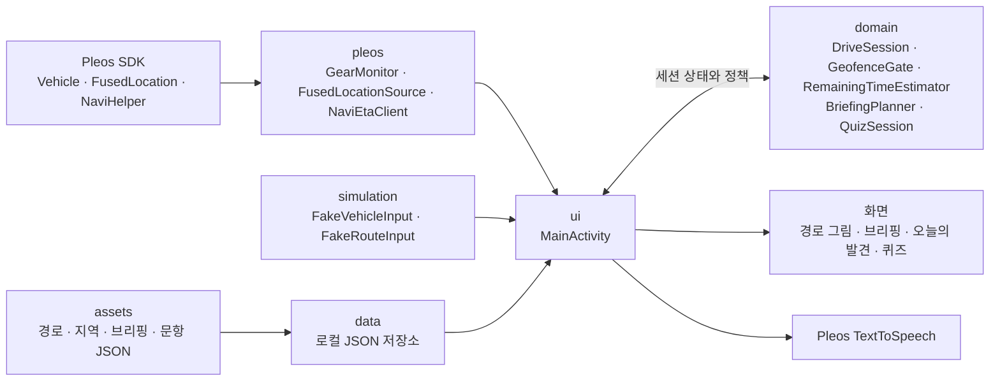

# Routeonomy

**출퇴근길에 듣는, 남은 시간과 지나가는 지역에 맞춘 경제 브리핑.**

자가용으로 출퇴근하는 직장인을 위한 Pleos Connect 차량용 앱입니다. 목적지까지 남은 시간에 맞춰 산업·경제 이야기를 들려주고, 지나가는 지역에 맞춰 주제를 바꿉니다. 도착해서 주차하면 오늘 들은 이야기를 돌아보고 퀴즈를 풀 수 있습니다.

현대자동차그룹 차량용 앱 개발 공모전 출품작

[시연 순서](docs/DEMO.md) · [시연 경로 GPX](tools/demo-route.gpx) · [검증 현황](docs/DEVELOPMENT_STATUS.md)

## 서울역에서 기흥역까지

| 주행 장면 | 앱에서 볼 수 있는 동작 |
| --- | --- |
| **서울역에서 출발** | 남은 시간에 맞춰 일반 브리핑을 고르고 음성으로 들려줍니다. 경로 그림에는 현재 위치와 판교 구간이 표시됩니다. |
| **판교 진입** | 판교 진입을 감지하면 전환 안내가 나옵니다. 듣던 이야기가 끝나면 판교의 산업·경제 이야기로 넘어갑니다. |
| **기흥역 도착 후 주차** | 목적지 근처에 도착하고 기어를 P로 바꾸면 오늘의 발견과 퀴즈를 열 수 있습니다. 퀴즈는 끝까지 들은 이야기에서 최대 3문항을 냅니다. |

시연은 에뮬레이터에서 GPX를 재생하고 **Pleos FusedLocation**으로 좌표와 근접 알림을 받는 방식입니다. 화면의 남은 시간은 시연 경로의 위치를 바탕으로 앱에서 추정합니다. 원고와 문항은 앱에 포함돼 있어 서버 없이 브리핑을 듣고 퀴즈를 풀 수 있습니다.

## 핵심 기능

| 기능 | 동작 | 확인한 범위 |
| --- | --- | --- |
| **F1 기어 모드** | D/R/N은 주행, P는 주차 화면으로 전환합니다. | Pleos AVD에서 Virtual Console의 P/D 전환을 확인했습니다. |
| **F2 경유 예측과 남은 시간** | 현재 위치와 목적지 좌표로 경유 지역을 예측하고, 목적지까지 남은 직선거리에 비례해 시연 시간을 추정합니다. | 계산을 단위 테스트로 확인했습니다. 최신 빌드의 경로 그림과 위치 갱신은 AVD 리허설에서 확인합니다. |
| **F3 브리핑 플래너** | 남은 시간 안에서 로컬 콘텐츠를 조합합니다. 시간이나 구간이 바뀌면 재생 중인 이야기를 유지하고 아직 시작하지 않은 목록을 다시 구성합니다. | 플래너를 단위 테스트로 검증했습니다. 시연 버튼으로 일반 브리핑에서 지역 브리핑으로 전환하는 흐름을 AVD에서 확인했습니다. |
| **F4 음성 브리핑** | Pleos TTS로 이야기를 문장 단위로 읽습니다. 일시정지·재개, 다음 주제, 완주 후 자동 진행을 지원합니다. | Pleos AVD에서 한국어 재생과 재생 조작을 확인했습니다. |
| **F5 지역 브리핑** | 판교 진입을 감지하면 현재 이야기가 끝난 뒤 판교 브리핑으로 전환합니다. | 시연 버튼을 통한 전환과 FusedLocation 근접 알림 수신을 AVD에서 각각 확인했습니다. 두 동작을 연결한 빌드의 통합 시연은 리허설 예정입니다. |
| **F6 주행 화면** | 큰 남은 시간과 현재 주제, 재생 상태를 표시합니다. 시연 중에는 경로 그림에서 현재 위치도 볼 수 있습니다. | 기존 주행 화면은 AVD D단에서 50km/h로 동작을 확인했습니다. 새 경로 그림의 AVD 표시는 리허설 예정입니다. |
| **F7 오늘의 발견** | 주차 상태에서 끝까지 들은 이야기의 주제·용어·출처를 보여줍니다. | Pleos AVD에서 완주 항목 표시, 건너뛴 항목 제외, D단에서 숨김을 확인했습니다. |
| **도착 후 퀴즈** | 기흥역 반경 300m에 진입해 도착 처리된 뒤 P단에서 퀴즈를 열 수 있습니다. 문항에 답하면 채점 결과와 해설을 보여줍니다. | 시뮬레이션 도착 입력으로 퀴즈를 AVD에서 확인했습니다. 기흥역 근접 도착부터 퀴즈까지 이어지는 흐름은 리허설 예정입니다. |

브리핑은 출퇴근길에 산업과 경제 개념을 이해하도록 돕는 콘텐츠입니다. 주차 상태와 목적지 도착은 독립적으로 관리하며, 퀴즈는 두 조건이 모두 충족될 때 열립니다.

## 실행 및 시연

| 항목 | 환경 |
| --- | --- |
| 에뮬레이터 | Pleos Connect v2.1.0, Android 14(API 34), 2560 × 1440 |
| 앱 빌드 | Android Studio, Android SDK 37, Gradle Wrapper |
| 시연 입력 | Extended Controls의 Location, Pleos Virtual Console |

```bash
./gradlew :app:assembleDebug
adb install -r app/build/outputs/apk/debug/app-debug.apk
```

1. Pleos AVD를 Cold Boot로 실행합니다. Extended Controls의 **Location**에서 시작 위치를 서울역으로 설정합니다.
2. Routeonomy를 열고 첫 실행에 표시되는 Pleos 위치 권한을 허용합니다. 출발 화면에서 일반 브리핑을 시작합니다.
3. **Location → Routes**에서 [시연 GPX](tools/demo-route.gpx)를 재생하고, Virtual Console에서 기어를 D로 바꿉니다.
4. 판교에 들어설 때 전환 안내와 다음 브리핑을 확인합니다. 기흥역 근처에 도착한 뒤 기어를 P로 바꾸고 퀴즈를 엽니다.

서울역 좌표, 권장 재생 속도, 위치 수신이 안 될 때의 대체 절차는 [시연 가이드](docs/DEMO.md)에 있습니다.

## Pleos SDK와 검증 범위

| SDK | 맡은 역할 |
| --- | --- |
| Vehicle 2.3.2 | 기어 신호를 받아 주행과 주차 화면을 전환합니다. |
| FusedLocation 1.1.3 | 위치와 근접 알림을 받아 경로 그림을 갱신하고, 판교 진입과 기흥역 근접 도착을 판정합니다. |
| TextToSpeech 3.3.1 | 한국어 브리핑을 문장 단위로 재생합니다. |
| NaviHelper 3.0.5 | 목적지까지 남은 시간과 거리를 진단 화면에서 조회합니다. 시연용 시간은 앱에서 추정합니다. |

Pleos AVD에서 기어 전환, 한국어 TTS, GPX 재생 중 위치 수신과 판교 근접 알림을 확인했습니다. 위치 입력부터 도착 후 퀴즈까지 이어지는 통합 시연은 AVD 리허설 예정입니다.

자동 검증은 단위 테스트, lint, 디버그 APK 빌드를 실행합니다.

```bash
./tools/verify.sh
```

## 아키텍처

단일 Android `:app` 모듈에서 `MainActivity`가 화면과 입력 소스, 브리핑 재생을 연결합니다. `domain`은 남은 시간 추정, 지역 진입 판정, 브리핑 구성, 퀴즈 채점을 담당합니다. `data`는 로컬 JSON을 읽고, `pleos`는 차량 SDK를 연결하며, `simulation`은 위치나 기어 신호를 받지 못할 때 시연 입력을 제공합니다.



위치 콜백과 근접 알림은 같은 진입 판정을 거쳐 한 번만 반영됩니다. 경로 그림은 시연 GPX와 같은 좌표를 사용하고, 브리핑 원고와 퀴즈 문항은 로컬 데이터에서 읽습니다. 패키지별 책임과 상태 흐름은 [아키텍처 문서](docs/ARCHITECTURE.md)에 있습니다.

## 기술 스택

- **언어** — Kotlin, Java
- **화면** — Android Activity와 Views, AppCompat, Material Components
- **구성** — 단일 Android `:app` 모듈, Gradle Kotlin DSL, Version Catalog
- **Pleos SDK** — Vehicle 2.3.2, NaviHelper 3.0.5, FusedLocation 1.1.3, TextToSpeech 3.3.1
- **테스트** — JUnit 4 기반 JVM 단위 테스트
- **빌드** — Gradle 9.6.0, Android Gradle Plugin 9.5.1
- **SDK 설정** — compileSdk 37, targetSdk 37, minSdk 28
- **시연 환경** — Pleos Connect v2.1.0 AVD, Android API 34

## 개발 문서

- [제품 명세](docs/PRODUCT.md)
- [아키텍처](docs/ARCHITECTURE.md)
- [개발 현황](docs/DEVELOPMENT_STATUS.md)
- [Pleos Connect SDK 공식 문서](https://document.pleos.ai/docs/pleos-only/connect-sdk-pleos/)

팀 [@beolene1](https://github.com/beolene1)
